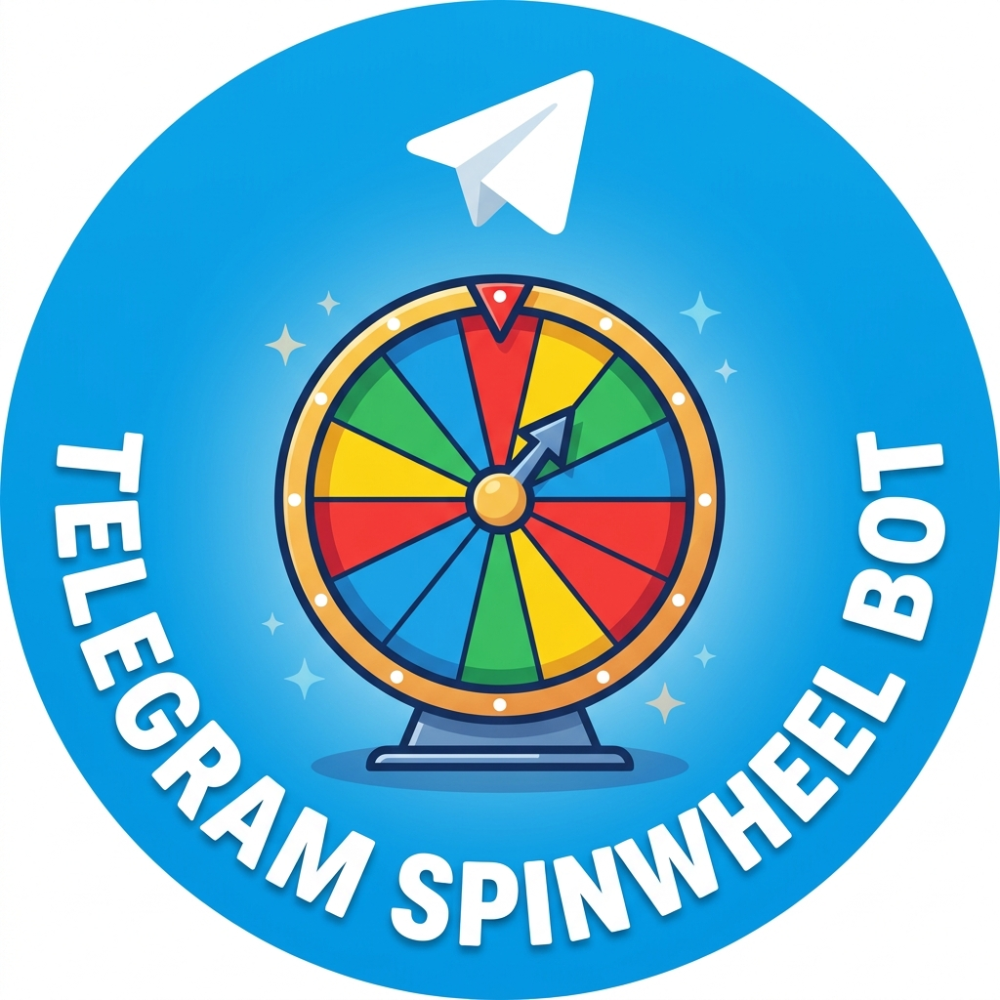

# Telegram Spin Wheel Bot

<p align="center">
  
</p>

<p align="center">
  <a href="https://t.me/tg_spinwheel_bot">Open @tg_spinwheel_bot in Telegram</a>
</p>

A Telegram bot for random picks in groups and channels. Anyone in the chat sends `/wheel` and chooses a mode:

- **Split into groups**: members join with a button, the starter picks the number of groups and members per group, and the bot posts the result as text and as an image.
- **Pick a winner**: members join with a button, the starter picks how many winners, and the bot posts the winners as text and as an image, followed by a celebration animation.
- **Coin flip**: an animated coin sticker, like the dice, then heads or tails.
- **Dice**: Telegram's animated dice, followed by a message with the number.

Built with Node.js, TypeScript, [grammY](https://grammy.dev), Prisma (Postgres) and `@vercel/og`. It runs on Vercel as a webhook and only needs a bot token and a database.

Made by Narihito.

## How it works

```
User: /wheel
Bot:  Spin Wheel
      Choose what to do:
      [Split into groups] [Pick a winner]
      [Coin flip] [Dice]
      [Exit]
User: taps [Split into groups]
Bot:  Spin Wheel by Narihito
      Not in the list? Tap Join. Want out? Tap Leave.
      Members (5): ...
      [Join] [Leave]
      [Start] [Exit]
Others tap Join...
User: taps [Start]
Bot:  6 members are in. How many groups?
      [2] [3] [4] [5] [6]
User: taps [2]
Bot:  2 groups. How many members per group?
      [1] [2] [3]
User: taps [3]
Bot:  2 groups, each with 3 members. 6 members in total. Do you want to start spinning?
      [Spin] [Back] [Exit]
User: taps [Spin]
Bot:  posts the result as text and as an image
```

- Pick a winner works the same way up to Start, then asks "How many winners?" (1 up to one less than the member count) and posts the winners as text and as an image, then sends an animated party popper.
- Coin flip and Dice are one tap. Coin flip sends an animated coin sticker that lands on the result, swaps it for a still coin once it lands (so it stops moving), then replies with "Name flipped Heads." Dice sends Telegram's animated dice and, once it stops, replies with "Name rolled a 4."
- While the bot works, only one bot message is shown: the panel is swapped for an animated sticker (spinning dots while fetching members, a turning wheel while spinning or picking). The sticker is removed when the result is posted. If the sticker cannot be sent, the panel stays and shows "Fetching members list...", "Spinning..." or "Picking..." instead.
- Buttons only offer choices that fit the member count. When only one size fits, the bot skips that question.
- Anyone in the chat can send `/wheel` and choose from the menu. Whoever chooses Split into groups or Pick a winner becomes the starter. Each chat has a 10 second cooldown between wheels.
- Anyone can tap Join or Leave. Only the starter can press Start, Spin and the number buttons.
- One wheel runs per chat. Tap **Exit** to close it: the starter or an admin can exit any time, and anyone can exit after 1 minute of no activity. Wheels with no activity for 10 minutes stop blocking new ones.
- `/start` explains how to use the bot. `/credit` shows who made it. `/donate` shows KPay details from env variables, so phone numbers never go into the code.

### Who is in the list

When `/wheel` starts, the bot scans the full member list of the group. It logs in to Telegram's MTProto API with its own bot token (no user account), which needs `TG_API_ID` and `TG_API_HASH` from [my.telegram.org](https://my.telegram.org). The login session is stored in the `Setting` table, so it only signs in once.

Scanning a big group takes a few seconds, so the scanned list can be cached in Redis for 10 minutes. Set `UPSTASH_REDIS_REST_URL` and `UPSTASH_REDIS_REST_TOKEN` (a free [Upstash](https://upstash.com) database, or the Upstash integration in the Vercel Marketplace, which sets `KV_REST_API_URL` and `KV_REST_API_TOKEN`). The bot talks to Redis over its REST API, so no extra package is needed. The cache for a chat is cleared when someone joins or leaves. Without Redis the bot scans on every `/wheel`.

If those two values are not set, or the scan fails, the bot falls back to members it has seen: admins, people who joined after it was added, and anyone who sent a message (the bot must be an admin to see these). Anyone missing can tap **Join**.

### Channels

Users can't send commands inside a channel. Channel admins send `/wheel` to the bot in a private chat and pick the channel. The list only shows channels where that person is an admin, so nobody sees chats they don't manage. The wheel menu is posted in the channel, where subscribers can choose a mode and tap Join. The bot needs permission to post and edit messages there.

## Setup

### 1. Requirements

- Node.js 20 or newer
- A Postgres database (for example a free [Neon](https://neon.tech) project)
- A bot token from [@BotFather](https://t.me/BotFather)

### 2. Install

```bash
npm install
cp .env.example .env
```

Fill in `.env`:

| Variable | Description |
| --- | --- |
| `BOT_TOKEN` | Bot token from @BotFather |
| `WEBHOOK_SECRET` | Random string using only `A-Z a-z 0-9 _ -`. Telegram sends it back so the webhook can reject fake requests |
| `WEBHOOK_URL` | Your Vercel URL, e.g. `https://your-app.vercel.app` |
| `DATABASE_URL` | Postgres connection string |
| `TG_API_ID` | Optional. App api_id from my.telegram.org, enables the full member scan |
| `TG_API_HASH` | Optional. App api_hash from my.telegram.org |
| `DONATE_NAME` | Optional. Account name shown by `/donate` |
| `DONATE_KBZPAY` | Optional. KPay number shown by `/donate` |
| `UPSTASH_REDIS_REST_URL` | Optional. Upstash Redis REST URL, caches member lists for 10 minutes |
| `UPSTASH_REDIS_REST_TOKEN` | Optional. Upstash Redis REST token |

### 3. Create the database tables

```bash
npm run db:deploy
```

### 4. Run locally

```bash
npm run dev
```

This removes any webhook and runs the bot with long polling. Add the bot to a test group as an admin, then send `/wheel`.

## Deploy to Vercel

1. Import this repo in Vercel (Framework Preset: Other).
2. In Project Settings -> Environment Variables, add every variable from `.env`.
3. Deploy. The webhook endpoint is `https://your-app.vercel.app/api/webhook`.
4. Apply migrations to the production database:
   ```bash
   npm run db:deploy
   ```
5. Register the webhook and the command menu, with `WEBHOOK_URL` in your local `.env` set to the Vercel URL:
   ```bash
   npm run webhook:set
   ```

To go back to local development, run `npm run dev` (it deletes the webhook). Run `npm run webhook:set` again afterwards.

## Scripts

| Script | Description |
| --- | --- |
| `npm run dev` | Run the bot locally with long polling |
| `npm test` | Run unit tests |
| `npm run typecheck` | Type-check the project |
| `npm run webhook:set` | Set the Telegram webhook, bot commands, description and about text |
| `npm run db:migrate` | Create and apply a migration in development |
| `npm run db:deploy` | Apply migrations in production |

## Project structure

```
api/webhook.ts                  Vercel function that receives Telegram updates
src/bot.ts                      Bot setup and handlers
src/dev.ts                      Local long polling runner
src/modules/chat/               Tracks chats the bot is added to, cooldown
src/modules/members/            Remembers members from messages, joins and admins
src/modules/spin/               /wheel menu, join panel, keyboards, split, winner, coin and dice logic, text and image output
src/modules/start/              /start and /help, also sent when the bot joins a chat
src/modules/credit/             /credit command
src/shared/                     Env config, Prisma client, bot MTProto client, Redis cache
scripts/                        Webhook setup
assets/                         Animated stickers (.tgs) for coin flip and loading, still coin stickers (.webp), uploaded once then reused by Telegram file id
prisma/schema/                  Database schema, one file per area, plus migrations
```

## Limits

- Big results are split: the image continues large groups on extra cards and spreads them over several pages, sent as albums of up to 10 (up to 20 pages, about 30 seconds of rendering). The text is split into several messages; if it would need more than 8, the bot sends a summary and the full list as a .txt file.
- The join panel lists up to 40 names and shows the rest as a count. Names longer than 80 characters are shortened in the image only.
- Image fonts are loaded from Google Fonts per image, only for the characters that appear: Latin, Myanmar, math and styled letters (𝓝𝓪𝓻𝓲, ⓃⒶⓇⒾ), symbols and playing cards, music, and about 30 other scripts (Canadian syllabics, Cherokee, Ethiopic, Runic, Georgian, Armenian, Khmer, Lao, Tibetan and more). Thai, CJK, Arabic, Indic scripts and emoji are loaded by @vercel/og. Characters that no font covers still show as a box.

## CI/CD

`.github/workflows/ci.yml` runs on every push and pull request to `main`:

1. **check**: `npm ci`, `npm run typecheck`, `npm test`
2. **deploy**: on pushes to `main` that pass the checks, builds and deploys to Vercel production

The deploy job needs these repository secrets (Settings -> Secrets and variables -> Actions):

| Secret | Where to find it |
| --- | --- |
| `VERCEL_TOKEN` | Vercel -> Account Settings -> Tokens |
| `VERCEL_ORG_ID` | `.vercel/project.json` after running `npx vercel link` |
| `VERCEL_PROJECT_ID` | `.vercel/project.json` after running `npx vercel link` |

If the secrets are not set, the deploy job skips itself. If you deploy with this workflow, turn off Vercel's own Git deployments (Project Settings -> Git) so each push is deployed only once.
